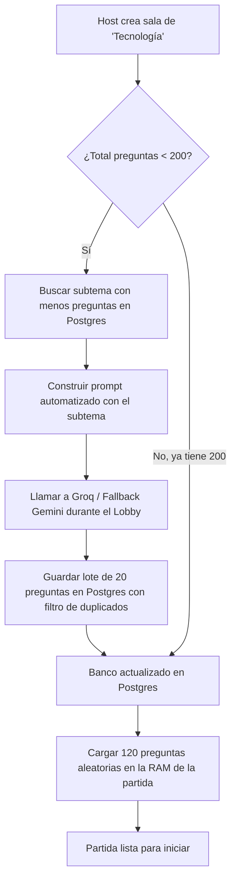

# Arquitectura Técnica y Registro de Decisiones (ADR) - v2.0

Este documento consolida las decisiones técnicas, estructurales, de UX de sala y de infraestructura acordadas para el desarrollo del juego.

---

## 1. Resumen de Decisiones Principales

| Componente | Elección | Justificación |
|---|---|---|
| **Frontend** | **Angular PWA** | Mobile-First, experiencia nativa en pantalla completa, Vibration API para alertas de hackeo, TypeScript estricto. |
| **Backend** | **NestJS + Socket.io** | Sinergia total con Angular, decoradores y módulos TypeScript, soporte nativo de WebSockets y salas dinámicas. |
| **Base de Datos** | **PostgreSQL (en Docker)** | Manejo nativo de `JSONB`, extensión `pg_trgm` para deduplicación y relaciones de subtemas para generación con IA. |
| **IA Proveedores** | **Groq + Gemini (Free Tiers)** | Groq (Llama 3) por ultra velocidad + Gemini Flash como fallback. Crecimiento progresivo durante el lobby hasta 200 preguntas/categoría. |
| **Autenticación** | **Sin Login (Zero-Friction)** | Acceso instantáneo por PIN o QR nativo. Salón de la Fama Arcade (nombres únicos de hasta 10 caracteres). |
| **Infraestructura** | **VPS Lightsail (4 GB RAM)** | Capacidad holgada para 25-40 salas simultáneas con Docker local. |

---

## 2. Flujo de Salas (Rooms), QR y Roles

### 2.1. Ingreso con Código QR Nativo (Sin cámara web)
- La pantalla del Host proyecta un **código QR dinámico** con la URL directa: `https://tudominio.com/join?pin=K7X2P9`.
- El jugador escanea con la cámara nativa de su teléfono (iOS/Android).
- La web se abre en el navegador móvil con el PIN precargado; el jugador solo escribe su **apodo** y pulsa "Unirse".

### 2.2. Resiliencia de Sala, Refresco y Migración de Host
- **Persistencia de Sesión al Refrescar:** Al recargar la página en el Lobby o partida (tanto Host como Jugador), el cliente utiliza `sessionStorage` y el evento `room:reconnect` para reasociar el nuevo socket sin generar un nuevo código PIN ni perder el estado del jugador.
- **Margen de gracia de 20 segundos para el Host:** Si el Host se desconecta, el servidor espera **20 segundos** de tolerancia antes de transferir la propiedad.
- **Traspaso en cascada:** Si el Host no regresa tras 20 segundos, la propiedad se transfiere al siguiente jugador conectado. Si ese nuevo Host se desconecta, se aplica exactamente la misma regla de 20 segundos.
- **Sala abandonada (5 minutos):** Si la sala queda con 0 jugadores conectados, el servidor espera **5 minutos** (300 segundos) antes de declararla terminada (`ENDED`) y destruirla de la memoria RAM.
- **Modalidad del Host y Unión al Lobby:** El anfitrión cuenta con selector visible ("Solo Proyectar" vs "Jugar en esta Sala"). Si elige jugar, personaliza su avatar (1..20) y apodo, confirmando su ingreso. Esto lo registra en `room.players` en el backend, sumándolo como nodo activo en el Lobby. Con el anfitrión jugando y 1 jugador adicional (2 personas en total), la partida queda habilitada para iniciar.
- **Feed Global de Sucesos en Vivo (Ticker):** Durante la partida, todos los jugadores visualizan los eventos clave (multiplicadores, hackeos iniciados/exitosos y defensas) en tiempo real en un banner superior.
- **Pantalla de Resumen Final y Redirección Automática (2 minutos):** Al terminar la partida, todos los jugadores (y el host) ven el Podio Top 3 y la lista completa con etiqueta `[ TÚ ]`. La pantalla cuenta con un botón de retorno y un temporizador regresivo de 2 minutos (120s) que los devuelve automáticamente al inicio.

---

## 3. Estrategia de Preguntas y Subtemas con IA



### 3.1. Carga Progresiva en el Lobby
- La meta máxima por categoría es de **200 preguntas**.
- Mientras los jugadores escanean el QR y se unen (30 a 60 segundos), el backend aprovecha ese tiempo muerto para consultar la API de IA en segundo plano si la categoría tiene menos de 200 preguntas.
- La pantalla muestra una barra sutil: *"Preparando banco de preguntas: 140/200"*.
- Una vez alcanzadas las 200 preguntas, la categoría nunca más vuelve a llamar a la IA.

### 3.2. Tabla de Subtemas (Generación 100% Automatizada)
Para evitar prompts manuales, la base de datos almacena subtemas por categoría:
- Al necesitar nuevas preguntas, el servidor busca automáticamente:
  ```sql
  SELECT s.id, s.name, COUNT(q.id) as total_questions
  FROM subtopics s
  LEFT JOIN questions q ON q.subtopic_id = s.id
  WHERE s.category_id = 'tecnologia'
  GROUP BY s.id, s.name
  ORDER BY total_questions ASC
  LIMIT 1;
  ```
- El backend inyecta ese subtema en una plantilla de prompt estándar:
  `"Genera 15 preguntas de trivia en español sobre el subtema '{name}', con 4 opciones..."`
- Esto garantiza que el banco de preguntas esté perfectamente distribuido sin esfuerzo manual.

---

## 4. Salón de la Fama Arcade (Récords Históricos)

- **Nombre / Tag:** Máximo **10 caracteres** (letras, números y guiones bajos, ej. `CYBER_MAX`, `NEO_99`).
- **Unicidad:** Los nombres son únicos en la tabla del salón de la fama. Si un jugador supera su propio récord previo con el mismo nombre, se actualiza su puntaje máximo.
- **Protección Anti-Cheat:** El puntaje solo puede ser registrado por el servidor tras validar la finalización de una partida legítima.

---

## 5. Esquema de Base de Datos PostgreSQL Definitivo

```sql
CREATE EXTENSION IF NOT EXISTS pg_trgm;

-- 1. Categorías Principales
CREATE TABLE categories (
    id VARCHAR(50) PRIMARY KEY,              -- 'tecnologia', 'cultura_general', 'ciencias'
    name VARCHAR(100) NOT NULL,
    description TEXT,
    target_pool_size INT DEFAULT 200
);

-- 2. Subtemas (Para balancear prompts de IA automáticamente)
CREATE TABLE subtopics (
    id UUID PRIMARY KEY DEFAULT gen_random_uuid(),
    category_id VARCHAR(50) REFERENCES categories(id) ON DELETE CASCADE,
    name VARCHAR(100) NOT NULL,              -- Ej: 'Ciberseguridad', 'Bases de Datos'
    prompt_keywords TEXT                     -- Palabras clave guía para la IA
);

-- 3. Banco de Preguntas
CREATE TABLE questions (
    id UUID PRIMARY KEY DEFAULT gen_random_uuid(),
    category_id VARCHAR(50) REFERENCES categories(id) ON DELETE CASCADE,
    subtopic_id UUID REFERENCES subtopics(id) ON DELETE SET NULL,
    question_text TEXT NOT NULL UNIQUE,
    options JSONB NOT NULL,                  -- ["Opción 1", "Opción 2", "Opción 3", "Opción 4"]
    correct_index SMALLINT NOT NULL CHECK (correct_index BETWEEN 0 AND 3),
    difficulty VARCHAR(10) DEFAULT 'medium',
    times_used INT DEFAULT 0,
    created_at TIMESTAMP WITH TIME ZONE DEFAULT NOW()
);

CREATE INDEX idx_questions_lookup ON questions(category_id, times_used);

-- 4. Sesiones de Partidas (Auditoría)
CREATE TABLE game_sessions (
    id UUID PRIMARY KEY DEFAULT gen_random_uuid(),
    room_code VARCHAR(6) NOT NULL,
    category_id VARCHAR(50) REFERENCES categories(id),
    total_players INT NOT NULL,
    duration_seconds INT NOT NULL,
    winner_nickname VARCHAR(10),
    winner_score BIGINT,
    started_at TIMESTAMP WITH TIME ZONE NOT NULL,
    ended_at TIMESTAMP WITH TIME ZONE DEFAULT NOW()
);

-- 5. Salón de la Fama Arcade
CREATE TABLE arcade_leaderboard (
    id UUID PRIMARY KEY DEFAULT gen_random_uuid(),
    game_session_id UUID REFERENCES game_sessions(id) ON DELETE SET NULL,
    category_id VARCHAR(50) REFERENCES categories(id),
    arcade_tag VARCHAR(10) NOT NULL UNIQUE,  -- Máximo 10 caracteres únicos
    score BIGINT NOT NULL,
    accuracy_percentage NUMERIC(5,2),
    hacks_count INT DEFAULT 0,
    created_at TIMESTAMP WITH TIME ZONE DEFAULT NOW()
);

CREATE INDEX idx_arcade_top ON arcade_leaderboard(category_id, score DESC);
```
