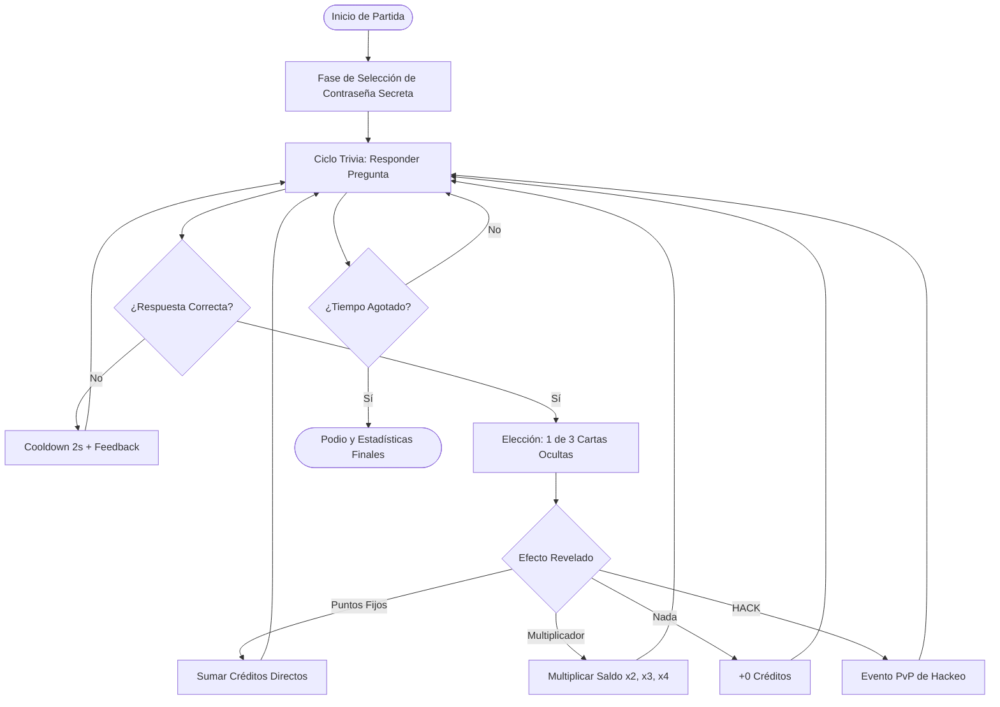
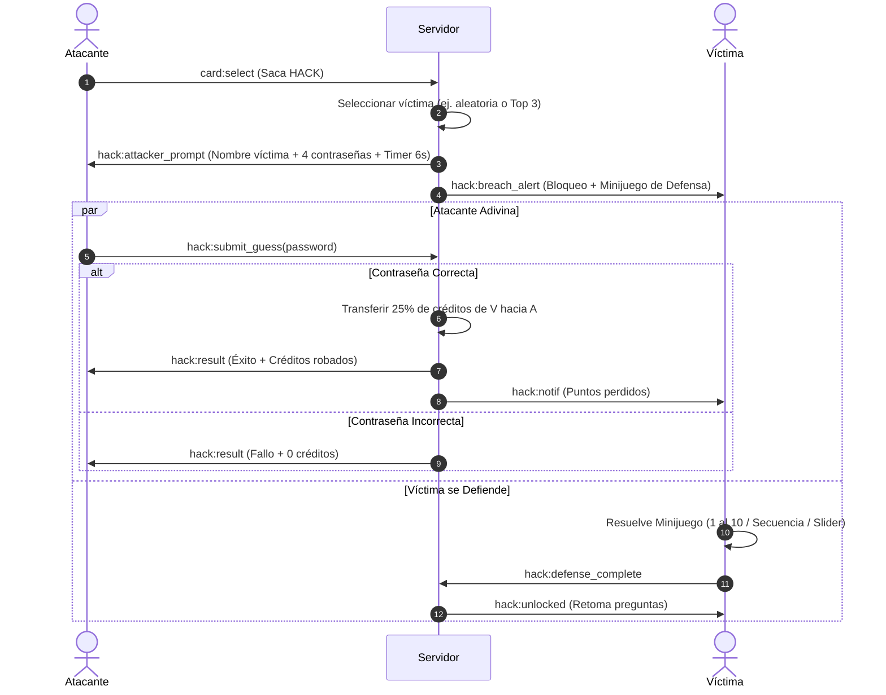

# Game Design Document (GDD): Trivia Cyber Hack

Documento de especificación técnica y de diseño de mecánicas para el desarrollo de un juego multijugador de preguntas y respuestas competitivo en tiempo real, inspirado en el modo *Crypto/Cyber Hack*.

---

## 1. Visión General del Proyecto

- **Género:** Trivia competitiva asíncrona en tiempo real con mecánicas PvP, azar ponderado (*gacha/loot box*) y robo de recursos.
- **Plataformas objetivo:** Web (Mobile-First y Desktop).
- **Audiencia:** Educativa, casual y de fiesta (*party game*).
- **Objetivo de la partida:** Acumular la mayor cantidad de puntos/créditos virtuales dentro del límite de tiempo configurado o hasta alcanzar una meta fija.

---

## 2. Bucle Central de Juego (Core Loop)



---

## 3. Estados de la Partida

### 3.1. Estado 0: Lobby y Configuración (Host)
- El anfitrión crea la sala y obtiene un **PIN de 6 dígitos**.
- **Modalidad del Host:** El anfitrión elige entre "Solo Proyectar" o "Jugar en esta Sala". Al elegir jugar, selecciona avatar y alias y confirma su unión, sumándose de inmediato como nodo activo en el Lobby.
- **Mínimo de Jugadores:** Se requieren al menos 2 personas en total (Host jugando + 1 jugador, o 2 jugadores sin host).
- **Persistencia y Refresco:** Al recargar la página en el Lobby o juego, no se genera un PIN nuevo; la sesión se reconecta de forma transparente.
- **Tolerancia a Desconexión (20s):** Si el Host se desconecta, se esperan 20 segundos antes de transferir el rol al siguiente jugador (regla en cascada). Si no queda nadie, se esperan 5 minutos antes de declarar la sala terminada (`ENDED`).
- Parámetros configurables:
  - **Condición de victoria:** Tiempo límite (3, 5, 7 o 10 min) o Meta de Puntos (ej. 500,000 pts).
  - **Set de preguntas:** Banco de preguntas de opción múltiple (4 opciones por pregunta).
  - **Tolerancia a errores:** Cooldown de 1 a 3 segundos tras fallo.

### 3.2. Estado 1: Asignación de Contraseña Secreta
- Antes de comenzar el cronómetro, cada jugador debe elegir en secreto **1 contraseña de una lista aleatoria de 5 opciones**.
- Ejemplos de contraseñas: `FIREWALL`, `CYBERBOT`, `QUANTUM`, `OVERDRIVE`, `MAINFRAME`.
- Esta contraseña se almacena de forma segura en memoria en el servidor.

### 3.3. Estado 2: Trivia Activa (Asíncrona)
- Los jugadores responden preguntas a su propio ritmo. No tienen que esperar al resto de jugadores.
- Las preguntas se consumen en bucle aleatorio o secuencial.
- Si fallan: visualizan la respuesta correcta y esperan una penalización breve.
- Si aciertan: avanzan inmediatamente a la **Fase de Cartas**.
- **Ticker Global de Sucesos en Vivo:** Los eventos de la partida (duplicadores, hackeos, robos y defensas) se emiten en vivo como mensajes rápidos en pantalla para que todos los jugadores compartan la misma información en tiempo real.

### 3.4. Estado 3: Resumen Final de Partida, Podio y Auto-Redirección (2 Minutos)
- Al finalizar el tiempo, todos los jugadores pasan a la pantalla de resumen.
- **Top 3 Destacado:** Se resalta el podio con badges #1, #2 y #3, avatares y puntajes finales.
- **Lista Completa:** Debajo se listan los demás jugadores (#4 en adelante) con resaltado `[ TÚ ]`.
- **Temporizador de Retorno:** Dispone de botón manual y temporizador regresivo de 2 minutos (120s) que redirige automáticamente a la pantalla principal.

---

## 4. Sistema de Cartas y Probabilidades (Drop Rates)

Tras cada acierto, el cliente muestra 3 cartas tapadas. El servidor determina de forma probabilística el botín:

### Tabla de Pesos y Probabilidades Base

| ID Carta | Nombre / Tipo | Efecto | Peso (Probabilidad) |
|---|---|---|---|
| `CARD_POINTS_SM` | Puntos Menores | +10 o +20 créditos | 39% (~29/74) |
| `CARD_POINTS_MD` | Puntos Medios | +30 o +50 créditos | 39% (~29/74) |
| `CARD_NOTHING` | Nada / Vacío | +0 créditos | 4% (~3/74) |
| `CARD_MULT_2` | Multiplicador Doble | Duplica el saldo total ($\times 2$) | 12% (~9/74) |
| `CARD_MULT_3` | Multiplicador Triple | Triplica el saldo total ($\times 3$) | 7% (~5/74) |
| `CARD_HACK` | Hackeo de Rival | Inicia evento de hackeo PvP | 12% (~9/74) |

> **Mecánica de Escalado Final (Late-Game Escalation):**
> En los últimos 60-90 segundos de juego:
> - La probabilidad de cartas de puntos fijos desciende al 20%.
> - La probabilidad de multiplicadores ($\times 2, \times 3, \times 4$) y Hackeos aumenta al 70%.
> - Esto provoca giros dramáticos en la tabla de posiciones y mantiene la adrenalina hasta el último segundo.

---

## 5. Especificación del Minijuego de Hackeo (PvP)



### 5.1. Pantalla del Atacante
- Se le indica a qué rival está atacando y su puntaje visible.
- Se le ofrecen **4 opciones de contraseña** (1 correcta y 3 distractores generados por el servidor).
- Temporizador regresivo de **6 segundos**.
- Si acierta: roba un porcentaje (entre **20% y 35%**) de los puntos actuales de la víctima.
- Si falla o expira el tiempo: 0 puntos robados.

### 5.2. Pantalla de la Víctima (Protocolo de Brecha)
- La pantalla activa una alerta visual (rojo parpadeante, alerta de audio `BREACH DETECTED`).
- La víctima no puede continuar respondiendo preguntas hasta completar una micro-tarea de seguridad:
  1. **Matriz Numérica (Number Matrix):** Una cuadrícula con botones desordenados del 1 al 10 que deben ser presionados en orden ascendente exacto.
  2. **Secuencia de Frecuencia (Memory Sequence):** Tocar 4 botones en el orden que se iluminaron (estilo Simón Dice).
  3. **Calibrador de Firewall (Slider Alignment):** Arrastrar un control deslizante y soltarlo dentro de la franja verde antes de que se mueva.
- Esta fricción crea una penalización de tiempo real: cada segundo en defensa es un segundo sin responder trivias ni multiplicar puntos.

---

## 6. Arquitectura de Software y Prevención de Trampas

### 6.1. Principio Server-Authoritative
El cliente web es una interfaz puramente representativa. Para evitar trampas:
1. **Validación de Respuestas:** El cliente envía el `questionId` y el `optionIndex` seleccionado. La respuesta correcta nunca se expone en el payload del frontend.
2. **Generación de Cartas:** Las 3 opciones presentadas al jugador son visuales; el resultado del botín se calcula en el servidor tras la selección.
3. **Contraseñas Secretas:** La lista de contraseñas de todos los jugadores permanece únicamente en la memoria de la sesión del servidor Node.js/WebSocket.

### 6.2. Esquema de Eventos WebSocket (Socket.io)

```typescript
// Mensajes Cliente -> Servidor
interface ClientToServerEvents {
  "room:join": (data: { roomPin: string; username: string }) => void;
  "player:set_password": (data: { password: string }) => void;
  "quiz:submit_answer": (data: { questionId: string; answerIndex: number }) => void;
  "cards:pick": (data: { cardSlot: number }) => void;
  "hack:guess_password": (data: { targetPlayerId: string; guessedPassword: string }) => void;
  "defense:completed": () => void;
}

// Mensajes Servidor -> Cliente
interface ServerToClientEvents {
  "game:state_changed": (data: { state: "LOBBY" | "PASSWORD_SETUP" | "PLAYING" | "ENDED" }) => void;
  "quiz:answer_result": (data: { correct: boolean; correctAnswerIndex?: number }) => void;
  "cards:reveal": (data: { chosenType: string; deltaPoints: number; multiplier?: number }) => void;
  "hack:trigger_attacker": (data: { targetPlayer: { id: string; name: string }; options: string[]; timeoutMs: number }) => void;
  "hack:trigger_victim": (data: { attackerName: string; miniGameType: "NUMBERS" | "SEQUENCE" | "SLIDER" }) => void;
  "hack:resolved_victim": (data: { stolenPoints: number }) => void;
  "leaderboard:update": (data: { rankings: Array<{ name: string; score: number }> }) => void;
}
```

---

## 7. Roadmap de Implementación Recomendado

1. **Sprint 1: Servidor WebSocket y Trivia Básica**
   - Configuración de Node.js + Express + Socket.io.
   - Creación de salas (PIN), conexión de clientes y ciclo simple de preguntas asíncronas con feedback instantáneo.
2. **Sprint 2: Sistema de Puntos y Cartas de Azar**
   - Lógica de barajado aleatorio y cartas de puntos fijos, vacías y multiplicadores.
   - Escalado dinámico de multiplicadores en base al tiempo restante de partida.
3. **Sprint 3: Módulo de Hackeo y Minijuegos de Seguridad**
   - Selección de contraseñas iniciales.
   - Orquestación síncrona entre atacante y víctima.
   - Desarrollo de los minijuegos de defensa para el frontend (Matriz 1-10 y Simón Dice).
4. **Sprint 4: UI/UX Premium, Audio y Polish**
   - Animaciones fluidas para voltear cartas.
   - Efectos sonoros (SFX de hackeo, alarma de brecha, fanfarria de podio).
   - Leaderboard interactivo en tiempo real para la pantalla del anfitrión.
