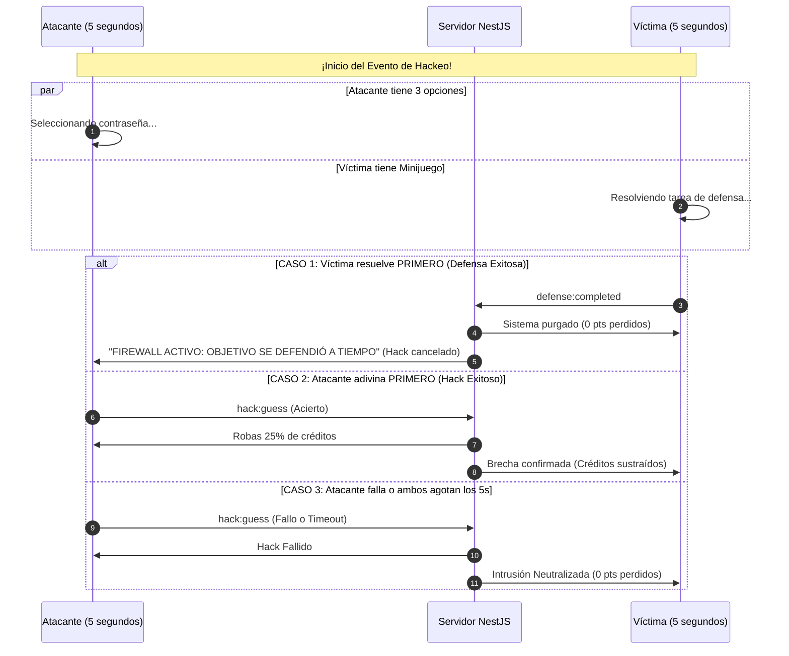

# Especificación de Diseño UI / UX: Terminal Hacker Minimalista (v2.0)

Documento maestro de diseño de interfaz de usuario (UI), experiencia de usuario (UX), componentes interactivos, sistema de avatares y minijuegos de defensa para el juego multijugador de trivia competitiva.

---

## 1. Filosofía Visual y Tokens de Diseño

Estilo visual: **Terminal Hacker Minimalista & Security Console**. Interfaz limpia, bordes nítidos, elementos de alto contraste para visibilidad instantánea en pantallas móviles y proyectores.

```
┌─────────────────────────────────────────────────────────────┐
│ PALETA CROMÁTICA: MATRIX TERMINAL                           │
│                                                             │
│  [ #0A0D0F ]   [ #12181C ]   [ #00FF88 ]   [ #FFB700 ]   [ #FF003C ]
│   Fondo Base    Superficie    Acento Verde   Acento Ámbar  Alerta Brecha
│   (Obsidiana)   (Consola)     (Terminal)    (Secundario)   (Rojo Glitch)
└─────────────────────────────────────────────────────────────┘
```

---

## 2. Sistema de Avatares Cibernéticos (20 Avatares)

Para que los avatares sean nítidos, carguen al instante y no consuman ancho de banda ni memoria:

### 2.1. Tecnología: SVGs Vectoriales Locales
- **Implementación:** 20 archivos SVG optimizados almacenados en los assets locales de Angular (`assets/avatars/bot-01.svg` a `bot-20.svg`).
- **Temática:** Robots, drones, cascos cibernéticos, agentes con visores y calaveras de código.
- **Sincronización Ultraligera:** En WebSocket y en memoria, el jugador solo transmite un entero: `avatarId: number` (del 1 al 20).
- **Peso total:** Menos de **25 KB** para los 20 avatares combinados. Cero peticiones a APIs externas; funciona offline y en cualquier resolución de pantalla sin pixelarse.

### 2.2. Experiencia de Selección en el Móvil:
En la pantalla de Join, el jugador ve su avatar en un círculo con borde verde neón. Tocar las flechas `[ < ]` y `[ > ]` rota entre los 20 avatares con animación fluida antes de presionar "Conectar".

---

## 3. Experiencia de Usuario: El Jugador Móvil (PWA)

```
┌──────────────────────────────────────┐
│ PANTALLA 1: INGRESO EXPRESS (JOIN)   │
├──────────────────────────────────────┤
│                                      │
│   > PROTOCOLO DE ACCESO _            │
│                                      │
│   SALA CONECTADA:                    │
│   [ K 7 X 2 P 9 ]  (Auto-relleno QR) │
│                                      │
│       [ < ]  ( 🤖 AVATAR #04 )  [ > ]│
│                                      │
│   INGRESA TU APODO (MAX 10):         │
│   ┌────────────────────────────────┐ │
│   │ CYBER_MAX                      │ │
│   └────────────────────────────────┘ │
│                                      │
│   ┌────────────────────────────────┐ │
│   │ [ CONECTAR AL SISTEMA ]        │ │ -> Botón Verde Neón
│   └────────────────────────────────┘ │
└──────────────────────────────────────┘
```

---

### 3.1. Pantalla de Trivia Activa (The Terminal Quiz)
- **Cabecera:** Reloj regresivo y contador dinámico de créditos.
- **Botones de Respuesta:** 4 botones de **64px de alto mínimo** con tipografía de 18px.
- **Feedback Háptico:**
  - Acierto: Destello verde + vibración corta (40ms) + pase a cartas.
  - Fallo: Agitación (*shake*) en rojo + vibración doble (100ms) + penalización de 2s.

---

### 3.2. Pantalla de Selección de 3 Cartas (Data Modules)
- **3 módulos sellados** `[ DATA-01 ]`, `[ DATA-02 ]`, `[ DATA-03 ]`.
- Al tocar una, se produce el volteo 3D revelando:
  - Puntos fijos (+10, +20, +50 créditos)
  - Multiplicadores ($\times 2, \times 3, \times 4$)
  - Vacío (0 créditos)
  - **¡HACK DIRECTO!**

---

### 3.3. Modo Atacante: Brecha de Seguridad (Target Breach)
Si el jugador saca la carta de **HACK**:

```
┌──────────────────────────────────────┐
│ [!] BRECHA INICIADA                  │
│ OBJETIVO: VALENTINA (18,400 pts)     │
│ TIEMPO RESTANTE: [||||||||| ] 3.8s   │
├──────────────────────────────────────┤
│ ¿CUÁL ES SU CLAVE? (1 de 3 opciones) │
│                                      │
│ ┌──────────────────────────────────┐ │
│ │ [A] QUANTUM_KEY                  │ │
│ └──────────────────────────────────┘ │
│ ┌──────────────────────────────────┐ │
│ │ [B] FIREWALL_X                   │ │
│ └──────────────────────────────────┘ │
│ ┌──────────────────────────────────┐ │
│ │ [C] CIPHER_ZERO                  │ │
│ └──────────────────────────────────┘ │
└──────────────────────────────────────┘
```

#### Reglas del Atacante:
1. **3 opciones visibles** (1 correcta y 2 distractores) -> **33.3% de probabilidad de éxito**.
2. **Temporizador de 5 segundos:** Barra de progreso roja descendiendo.
3. **Resultado:**
   - Si acierta antes de que la víctima se defienda: Roba entre el 20% y 35% de los puntos de la víctima.
   - Si falla o expira el tiempo: *"HACK FAILED: 0 CRÉDITOS ROBADOS"*. La víctima no pierde absolutamente nada.

---

## 4. Modo Víctima: La Carrera Atacante vs. Víctima y los 3 Minijuegos

Cuando un jugador es objetivo de un hackeo, se desata una **carrera contra el reloj síncrona en tiempo real**:



> **Regla de Cierre Rápido (Timeout de 5s):**
> Si la víctima tarda más de 5 segundos en resolver el minijuego, la pantalla de defensa se retira automáticamente y el jugador regresa a las preguntas normales para evitar que quede atrapado.

---

### Los 3 Minijuegos de Defensa

Al dispararse la alarma, el servidor asigna aleatoriamente **uno de estos tres minijuegos**:

#### Minijuego 1: Matriz Numérica Ascendente (1 al 10)
- **Dinámica:** Cuadrícula de 10 botones desordenados del 1 al 10.
- **Acción:** Tocar en orden estricto `1 -> 2 -> 3 ... -> 10`.
- **Efecto:** Cada botón tocado en orden correcto se ilumina en verde y se desactiva. Si se presiona un número fuera de orden, se produce una vibración de error y la secuencia se reinicia al 1.

```
┌──────────────────────────────────────┐
│ [⚠] ¡BRECHA EN CURSO!                │
│ PURGA: TOCA DEL 1 AL 10 EN ORDEN     │
├──────────────────────────────────────┤
│ SIGUIENTE: [ 4 ]                     │
│                                      │
│   [ 7 ]    [ 2✔]    [ 10 ]           │
│   [ 1✔]    [ 5 ]    [ 3✔ ]           │
│   [ 9 ]    [ 4 ]    [ 6 ]            │
│   [ 8 ]    [ -- ]   [ -- ]           │
└──────────────────────────────────────┘
```

#### Minijuego 2: Secuencia de Frecuencia (Simón Dice Cibernético)
- **Dinámica:** 4 cuadrantes de colores (`Cian`, `Verde`, `Ámbar`, `Magenta`).
- **Acción:** El sistema hace parpadear una secuencia de 4 pasos (ej: `Verde` -> `Cian` -> `Verde` -> `Ámbar`).
- **Interacción:** El jugador debe reproducir la secuencia tocando los cuadrantes en el mismo orden. Si acierta los 4, purga el sistema inmediatamente.

```
┌──────────────────────────────────────┐
│ [⚠] RECALIBRA EL FIREWALL            │
│ REPITE LA SECUENCIA DE 4 PULSOS      │
├──────────────────────────────────────┤
│                                      │
│       ┌─────────┐   ┌─────────┐      │
│       │  [VERDE]│   │  [CIAN] │      │
│       └─────────┘   └─────────┘      │
│       ┌─────────┐   ┌─────────┐      │
│       │ [ÁMBAR] │   │[MAGENTA]│      │
│       └─────────┘   └─────────┘      │
│                                      │
│ PROGRESO: [ ● ● ○ ○ ]                │
└──────────────────────────────────────┘
```

#### Minijuego 3: Sincronizador de Frecuencia (Slider Lock)
- **Dinámica:** Una barra con un cursor que oscila velozmente de izquierda a derecha. En el centro hay una pequeña "zona verde" segura.
- **Acción:** Un botón grande abajo que dice **`[ BLOQUEAR SEÑAL ]`**.
- **Interacción:** El jugador debe presionar el botón justo cuando la aguja cruza la franja verde. Si acierta en el blanco, la intrusión queda repelida al instante.

```
┌──────────────────────────────────────┐
│ [⚠] SINCRONIZACIÓN DE DEFENSA        │
│ DETÉN LA AGUJA EN LA ZONA VERDE      │
├──────────────────────────────────────┤
│                                      │
│  [-------[  ZONA VERDE  ]-------]    │
│                 ▲ (Aguja en movimiento)
│                                      │
│  ┌────────────────────────────────┐  │
│  │     [ BLOQUEAR SEÑAL ]         │  │
│  └────────────────────────────────┘  │
└──────────────────────────────────────┘
```

---

### ¿Con qué tecnología implementamos estos minijuegos?

**Tecnología: Componentes Puros de Angular + CSS Animations (Sin librerías pesadas)**

- **No usamos Canvas ni Phaser:** Motores de juegos como Phaser o Unity WebGL añaden 5 a 15 MB de descarga y son lentos en celulares de gama media/baja.
- **La Solución Pro:** Creamos tres componentes Angular independientes:
  - `<app-defense-matrix>`
  - `<app-defense-simon>`
  - `<app-defense-slider>`
- **Ventajas:**
  1. **Cero latencia:** Se ejecutan en el DOM nativo con eventos táctiles `(touchstart)` o `(click)` que responden a 60 FPS sin retraso.
  2. **Animaciones por GPU:** Efectos de pulso y movimiento del slider usando CSS puro (`transform: translateX()`), consumiendo 0% de batería.
  3. **Vibración Nativa:** Integración directa con `navigator.vibrate()`.

---

## 5. Experiencia del Host (Proyector o Jugador)
- **Selector de Modo Visible:** Dos tarjetas de selección directa:
  - `[ 📺 SOLO PROYECTAR ]`: Para pantallas grandes de televisión o proyector donde el host actúa de presentador.
  - `[ 🎮 JUGAR EN ESTA SALA ]`: Permite al anfitrión participar desde su pantalla. Al seleccionarlo, se despliega:
    - Selector táctil de avatar sticker (1 a 20 con flechas `[ < ]` y `[ > ]`).
    - Campo de apodo (máximo 20 caracteres).
    - Botón `[ UNIRME AL LOBBY COMO JUGADOR ]`.
  - Al unirse, el host se suma de inmediato como nodo activo en la lista del lobby ("NODOS CONECTADOS").
  - **Condición de Inicio:** Con el anfitrión jugando y 1 jugador externo (total 2), el botón `[ ¡INICIAR PARTIDA! (2 LISTOS) ]` se activa.

---

## 6. Feed Global de Sucesos en Vivo (Live Cyber Ticker)
- Se renderiza mediante el componente nativo `<app-game-ticker>`.
- Muestra mensajes breves y rápidos con badges de alerta que se actualizan para todos los jugadores en simultáneo:
  - `[ LIVE ] ⚡ CYBER_MAX activó un Multiplicador x2`
  - `[ LIVE ] ⚠️ VALENTINA desplegó un ciberataque contra NEO_99`
  - `[ LIVE ] 🚨 VALENTINA hackeó el sistema de NEO_99 (+450 PTS)`
  - `[ LIVE ] 🛡️ NEO_99 repelió la intrusión con su Firewall`

---

## 7. Pantalla de Resumen Final (Podio, Lista y Redirección a los 2 Minutos)
- Implementada en el componente `<app-match-summary>`.
- Estructura:
  1. **Top 3 Hacker Console:** Podio con tarjetas para #1 (Oro / Verde Neón), #2 (Plata / Cian) y #3 (Bronce / Ámbar).
  2. **Lista Completa:** Tabla compacta para jugadores del #4 en adelante con el resaltado distintivo `[ TÚ ]`.
  3. **Auto-Redirección tras 2 Minutos (120s):** Contador regresivo en tiempo real (`Redirigiendo a inicio en: 119s`) y botón `[ VOLVER AL INICIO ]`. Al terminar el tiempo, tanto los jugadores como el anfitrión regresan automáticamente a la vista inicial (`/`).
